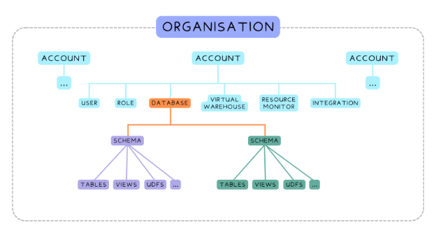
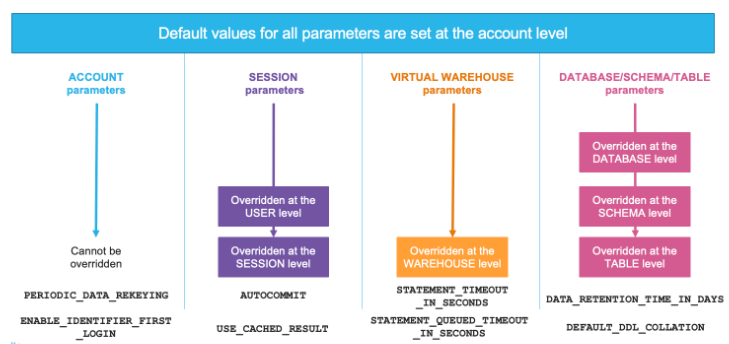
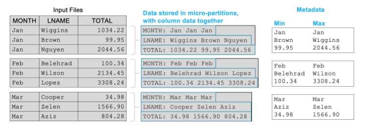
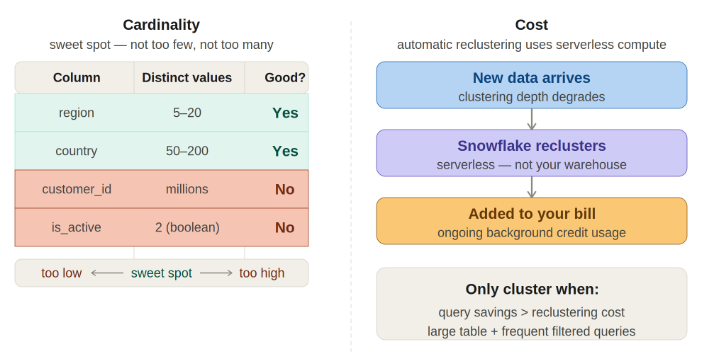
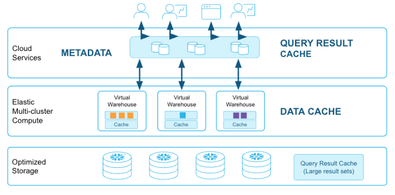
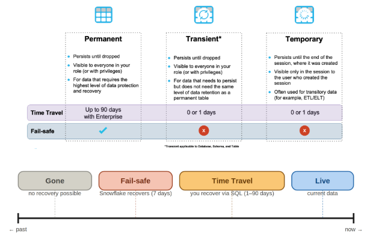
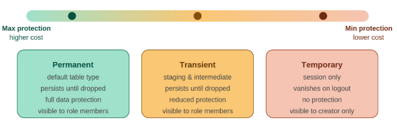
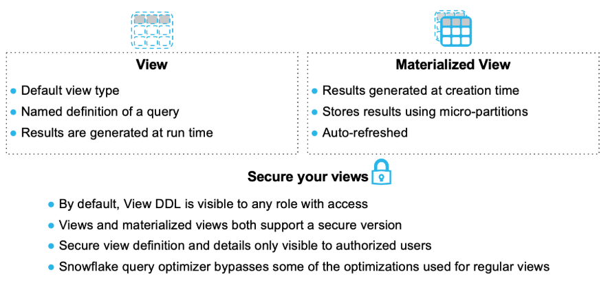

# Snowflake

Snowflake is a cloud-based column-based storage data warehouse that runs on AWS, Azure, and Google Cloud. It's a fully managed service that separates compute and storage, so you only pay for what you use. It automatically scales to handle large datasets and delivers fast SQL query performance. It's popular for analytics, business intelligence, and data pipelines, and features unique data-sharing capabilities that let you securely share data across organizations without copying. Excellent for data analytics.

## Object hierarchy

<p align="center">
  
</p>

Session variables let you store and reuse values within a script. Set one with the SET function, for example, SET min_users = 100 then reference it anywhere in that session using dollar sign min_users.

Account parameters sit at the top and can't be overridden. Whatever is set at the account level is what applies, things like PERIODIC_DATA_REKEYING.

Session parameters work differently. The account sets a default, an administrator can override it for a specific user, and the user can override it again within their active session. The lowest level at which the parameter is set wins.

Virtual warehouse parameters follow a simpler two-level chain: account default, then overridden at the warehouse itself. STATEMENT_TIMEOUT_IN_SECONDS is the classic one — you might want a tighter timeout on your dashboard warehouse than the account default allows.

Finally, database, schema, and table parameters cascade down through the object hierarchy. Set a default at the account level, override it at the database, narrow it further at the schema, and override it again on a specific table. DATA_RETENTION_TIME_IN_DAYS works this way, your account might default to one day, but your more important billing tables get thirty. The rule across all four types is the same: the lowest level at which the parameter is set will be used, and that value wins.

<p align="center">
  
</p>

## Micro partitioning and pruning

When data is loaded into Snowflake, it automatically gets divided into micro-partitions, which are chunks of on-disk storage on the order of 50 to 500 MB of uncompressed data. For every micro-partition that Snowflake creates it stores metadata including min and max value for each column, the row count, null counts and distinct value counts. This metadata is stored in the cloud services layer and is maintained automatically as data is loaded and updated.

Pruning only works well when the column you are trying to filter on is well-clustered, meaning that the rows with similar values are grouped together in the same micro-partitions.

<p align="center">
  
</p>

Clustering is like an index in traditional databases like postgres.

A clustering key makes sense when three things are true: the table is large enough that pruning actually matters, 100Gb or bigger tables, you're consistently filtering on the same column; and that column is poorly clustered, meaning pruning isn't working for it.

<p align="center">
  
</p>


## Caching 
Snowflake uses three types of caches, each serving a different purpose:

| Cache Type | Location | Purpose | Warehouse Required? |
|---|---|---|---|
| Result Cache | Cloud Services | Stores complete query results and returns them without re-executing the query. | No |
| Warehouse Cache | Warehouse SSD and memory | Stores recently scanned data to speed up subsequent queries. | Yes |
| Metadata Cache | Cloud Services | Stores table metadata, statistics, and row counts, allowing simple queries to be answered without scanning table data. | No |

<p align="center">
  
</p>

### 1. Result Cache
- Reuses complete query results without re-executing the query.
- Requires identical query text, unchanged underlying data, deterministic functions, available cached results, and appropriate privileges.
- TTL: 24 hours, resetting on reuse, up to a maximum of 31 days.
- `SELECT` requires access to underlying tables; `SHOW` requires the same role.

### 2. Warehouse Cache
- Stores recently scanned micro-partitions in warehouse SSD and memory.
- Similar queries can reuse cached data instead of reading from cloud storage.
- Cache is dropped when the warehouse suspends.
- **Best practice:** Consider setting `AUTO_SUSPEND` to at least 10 minutes for frequently executed workloads.

### 3. Metadata Cache
- Always available in Cloud Services.
- Stores table metadata, statistics, and row counts.
- Simple queries, such as `SELECT COUNT(*)`, can sometimes be answered without scanning table data or using a warehouse.

After running queries on a dashboard, Anyone with access to the dashboard and the same primary role can view the cached results.

## Table Types and Views

<p align="center">
  
</p>

<p align="center">
  
</p>

<p align="center">
  
</p>

**Time Travel** is like a version control within snowflake. Time Travel lets you query data as it existed at any point within the retention window. In standard edition you only have 1 day of data retention, while in enterprise you have up to 90 days.

**Fail-safe** is an additional layer of protection. Beyond the Time Travel window, Snowflake automatically holds your data for a further seven days in Fail-safe. You can't query it yourself during that period, but if you need it, Snowflake Support can recover it for you. This is your last resort. 

## Security and Access Control
RBAC: Role Based Access Control, Privileges, such as SELECT, INSERT, etc are granted to roles (analyst_role), which are assigned to users (some_email). Never assign privileges to users, don't skip the role step.

ACCOUNTADMIN for account-level administration, SECURITYADMIN for the security landscape, and SYSADMIN for data infrastructure.

Three grants are required to give the a role access to a table: USAGE on the database, USAGE on the schema, and SELECT on the table. The most common mistake is granting SELECT and forgetting the USAGE grants.The hierarchy enforces that every level of access is deliberate.

There is an additional level of security available, column-based security, this approach uses a masking policy to show the column with the values are masked. 

## Management & Governance
Credits are the unit of cost. One credit equals to one hour of a Standard Gen 1 X-Small warehouse running continuously. Credit consumption depends on warehouse type and size. Credit consumption doubles when the warehouse size increases; XS consumes 1, S consumes 2 credits, M consumes 4 credits, L consumes 8 credits and so on. For example, A Large (L) warehouse consumes 8 credits per hour. if it runs for 3.5 hours it will consume 28 (8 × 3.5) credits in total, assuming it auto suspends when it finishes.
Virtual warehouses usage is billed per second with a one-minute minimum. Cloud services layer (authentication, query optimization, metadata) are only charged if the cost is above 10% of daily warehouse compute.

ACCOUNT_USAGE is a schema inside the SNOWFLAKE system database that Snowflake maintains for every account. It contains views that expose historical data: queries run, credits consumed, storage used, logins recorded etc. The data has a latency of up to three hours, so it's not suitable for real-time monitoring and most views retain data for 365 days, giving you a full year of history to query against.

| Feature          | ACCOUNT_USAGE                                | INFORMATION_SCHEMA                    |
|------------------|----------------------------------------------|---------------------------------------|
| Scope            | History of entire account, all databases     | Current state of your database        |
| Data latency     | Up to 3 hours                                | Low latency                           |
| Retention        | Up to 365 days                               | Up to 6 months (varies by view)       |
| Dropped objects  | Included                                     | Not included                          |
| Primary use case | Historical audit and cost analysis           | Current state and metadata            |

WAREHOUSE_METERING_HISTORY answers which warehouses consumed the most credits.

ACCOUNT_USAGE.QUERY_HISTORY records every query run in the account - who ran it, on which warehouse, how long it took, and how much data it scanned.

STORAGE_USAGE tracks how much storage the account is consuming over time - both active data storage and Fail-safe storage. The raw values are in bytes; dividing by 1024 to the power of three converts to gigabytes.

ACCOUNT_USAGE.LOGIN_HISTORY records every login attempt against the account - successful or not.

Zero-copy cloning does not write new micro-partitions at creation time. The clone and the source share the same physical storage. Storage cost only increases as the two tables diverge.

## Stages
There are two types of stages: internal and external. Internal stages are managed by Snowflake. External stages point to a location on a external provider such as Amazon S3, Azure Blob Storage, or Google Cloud Storage, and let you load data from there into Snowflake tables.

There are three types of internal stages: user, table and named. A user stage is a personal staging area for a single user. A table stage is tied to a specific table therefore multiple users can stage files there, but they can only load into that one table. These two types of stages are created automatically by Snowflake. A named stage is a database object created in a schema, making it shareable across roles and sessions. Similarly, an external stage can have a named stage that's location is on a cloud provider and acts as a pointer to it's external cloud location.

COPY INTO is the command that moves data from a stage into a Snowflake table. The batch solution. The target is the fully qualified table name. FROM specifies the stage and path. FILE_FORMAT references the named format object. And ON_ERROR controls what happens if Snowflake encounters a bad row. This single command replaces what would otherwise be a multi-step ETL process. The data is already in the stage. COPY INTO reads it, parses it, and loads it.
Before loading, run the same COPY INTO command with VALIDATION_MODE = RETURN_ERRORS. Snowflake parses the file and surfaces any rows that would fail, without touching the target table.
Errors are written to the INFORMATION_SCHEMA.COPY_HISTORY table.

A Snowpipe wraps a COPY INTO statement and triggers it automatically as new files arrive in a stage. Snowpipe fires each time a new file lands. Loads happen in micro-batches within minutes. And because it's serverless, there's no warehouse to provision or manage. This is the streaming solution.

Snowflake recommends splitting data into multiple files (about 100/250 MB each) to leverage parallel loading.

Any JSON file can be exploded into a relational tabular format of multiple rows and columns using the `LATERAL FLATTEN` combo. For the opposite conversion, table to JSON file, use the `OBJECT_AGG` function.

List all files in a stage running `LIST @stage_name`

## External Tables
Tables that are created on the fly when snowflake reads data from any cloud provider. This process doesn't load the data into snowflake. Snowflake stores metadata of the file. As files are stored outside of snowflake, there is no storage charge associated to it. Best for infrequently queried, archive data. 

## Iceberg Tables 
Originally developed at Netflix and donated to the Apache Software Foundation. It was designed with multi-engine interoperability as a central goal.
It is an open table format that manages parquet data files and metadata. it is highly enriched with additional features to its metadata. The key idea is that Iceberg makes files in a data lake behave much more like proper database tables, with features such as transactions, schema evolution, partition evolution and time travel.
Databricks has its own solution; Delta tables. 

## Functions
### User Defined Functions
```
CREATE OR REPLACE FUNCTION function_name(
    --argument argument_type, 
    start_time TIMESTAMP
    end_time TIMESTAMP, 
    calories_burned NUMBER
)
-- Return type(eg: NUMBER)
RETURNS NUMBER 
AS
$$
-- What the function does
DATEDIFF(MINUTE, start_time, end_time) / calories_burned
$$;
```
## Snowflake Query Execution Order
| Order | Clause | Purpose |
|-------|--------|---------|
| 1 | FROM | Identifies the source table(s) to query from |
| 2 | WHERE | Filters rows based on specified conditions before grouping |
| 3 | GROUP BY | Groups rows into subsets based on specified columns |
| 4 | HAVING | Filters groups based on aggregate function conditions |
| 5 | SELECT | Selects which columns and expressions to return |
| 6 | Window Functions | Computes values over a set of rows (ROW_NUMBER, RANK, LAG, LEAD, etc.) |
| 7 | QUALIFY | Filters rows based on window function results |
| 8 | DISTINCT | Removes duplicate rows from results |
| 9 | ORDER BY | Sorts the result set in ascending or descending order |
| 10 | LIMIT | Restricts the number of rows returned |

### Window Functions
Window Functions are calculated after SELECT but before ORDER BY. QUALIFY is used to filter results based on window function conditions.

General Syntax:
```sql
FUNCTION(column) OVER (
    PARTITION BY grouping_column
    ORDER BY sorting_column
    ROWS BETWEEN UNBOUNDED PRECEDING AND CURRENT ROW
)
```
- PARTITION BY: Divides data into independent groups.
- ORDER BY: Defines the sequence of rows within each group.
- ROWS / RANGE: Defines which rows are included in the window frame.

## Streams
A stream tracks every insert, update, and delete made to a table since it was last consumed. It doesn't duplicate the data, it maintains a running change log.

Snowflake has three stream types. 
- Standard streams capture all inserts, updates, and deletes. 
- Append-only streams track only new rows, ignoring updates and deletes. Records written once and never modified, this is more efficient. 
- Insert-only streams are designed for external tables and directory tables. A directory table surfaces metadata about files in a stage - every file's name, size, and last modified timestamp. Since files are added but not updated in place, insert-only is the right fit.

Check if a stream has data by running `SELECT SYSTEM$STREAM_HAS_DATA(‘stream_name‘)`. This returns a boolean value.

## Tasks & DAG Orchestration
A task wraps a SQL statement and runs it on a schedule, automatically. Tasks are scheduled on a using CRON syntax.

DAG stands for Directed Acyclic Graph. A chain of events or sql statements running one after the other. DAGs are used to set how tasks are executed. 

Streams are used in conjunction with tasks to read data in a near real time fashion and execute processes in a given order when conditions are met. 

## Dynamic Tables
A Dynamic table automatically updates its data based on a SQL query you define. Data freshness is set with the TARGET_LAG parameter. `TARGET_LAG = '10 minutes'` does not mean Snowflake refreshes exactly every 10 minutes. It is a freshness target, not a guaranteed schedule. It can be set to `DOWNSTREAM` to chain multiple tables refresh, this is useful when there are dependencies across tables.

The main difference between a Dynamic Table and a Materialized View is that they both store precomputed query results, but they serve different purposes. 
- Materialized View: Primarily improves query performance by storing the results of a query. Having clauses, window functions and complex joins are not supported.
- Dynamic Table: Builds and maintains a transformed dataset that you can use as part of a data pipeline.

Snowflake decides whether each refresh is full or incremental. 

[Snowflake guide: Choosing between Dynamic Tables, Materialized Views, and Tasks](https://docs.snowflake.com/en/user-guide/dynamic-tables/decision-guide)

## Query Optimization
### Query Profile
Query Profile in Snowflake is a visual execution plan that shows you how Snowflake executed a SQL query.
The operator tree is a visual representation of the planned steps taken by the plan to execute the query.

It helps you understand where your query spends time, which operations consume the most resources, whether Snowflake is scanning too much data, whether joins are creating performance bottlenecks.
- Whether your query is spilling data to disk.
- Which parts of your SQL you should optimize.

**What to look when optimizing a query:**
1. Partitions scanned vs partitions total

Suppose your table contains 10,000 micro-partitions. If partitions scanned are 9,500 then your query is scanning 95% of the table. That might indicate poor micro-partition pruning.
Ideally, Snowflake should eliminate irrelevant partitions based on your filter conditions.

2. Bytes scanned

This tells you how much data Snowflake had to read. High bytes scanned can indicate; 1. Reading unnecessary columns, 2. Missing or ineffective filtering, 3. Scanning a very large table.

3. Spilling to local or remote storage

Sometimes Snowflake doesn't have enough memory available for an operation. So it has to spill data to complete the execution. Spilling can happen during joins, sorts and aggregations.

It can spill intermediate data:
- Local spill: Uses local storage associated with the execution resources.
- Remote spill: Uses remote storage, generally indicating more expensive processing. Must be addressed. 

4. Join explosion

Imagine joining two tables; Flights: 1 million rows and Customers: 100,000 rows.
If your join condition is incorrect, the result might contain hundreds of millions of rows. Look for unexpected increases in the number of rows after a join.

5. Execution time by operator

Identify which operations consume the most execution time. For example, if a join accounts for 70% of the execution time, optimizing that join is probably more valuable than optimizing a small filter operation.

While the query profile is used to investigate queries one by one, `SNOWFLAKE.ACCOUNT_USAGE.QUERY_HISTORY` tells you which queries across your whole account are the worst offenders and it retains a year of history. 

| Query Profile Diagnosis | Recommended Method | Purpose |
|---|---|---|
| Equality lookup scans almost the entire table | Search Optimization | Accelerates selective equality lookups by efficiently finding matching rows. |
| Heavy, unpredictable scans | Query Acceleration Service (QAS) | Offloads portions of large, scan-heavy queries to serverless compute. |
| Same filter columns in most queries, but weak micro-partition pruning | Automatic Clustering | Reorganizes data to improve micro-partition pruning for frequently filtered columns. |
| Same expensive aggregation executed repeatedly | Materialized View | Precomputes and stores query results to avoid repeatedly performing expensive aggregations. |

## Miscellaneous knowledge
**SEQ4** : generates a unique, increasing 4-byte integer sequence number (64-bit signed integer) for each row. For example, generating 30 days; `SELECT DATEADD(day, -SEQ4(), current_date()) AS date_actual FROM TABLE(generator(rowcount => 30)) ORDER BY date_actual DESC;`

**RANGE vs ROWS** : Windows functions can be set on a set on a fixed number of rows or a more dynamic for duplicate values. - ROWS defines the window based on the physical number of rows, while RANGE defines the window based on the values of the ORDER BY column. For example; `ROWS BETWEEN 2 PRECEDING AND CURRENT ROW` Includes the current row and the 2 previous physical rows, regardless of their values. While `RANGE BETWEEN 2 PRECEDING AND CURRENT ROW` Includes all rows whose ORDER BY value falls within the range of 2 units before the current value, including the current value, regardless of the number of rows with that same value.

It is commonly used to generate row numbers, create test data, and generate sequences of dates or numbers.
**GET_PRESIGNED_URL**: This function generates a time-limited download link that requires no Snowflake credentials. This link can be shared with anyone so they can download the data: 
`SELECT GET_PRESIGNED_URL(@my_stage, 'file_name.json', 3600)`

**PARSE_JSON**: creates a VARIANT value from a valid JSON string.

**ARRAY_SIZE** function to count number of elements in an ARRAY. For example; `SELECT ARRAY_SIZE(v:children) AS total_children FROM my_json;`

**OBJECT_AGG**: Aggregate function that combines multiple rows into a single OBJECT (JSON-like key-value structure). It is an aggregate function so you need to group by another column. `ARRAY_AGG` is a similar function that returns an array instead of a json. 

**SPLIT_TO_TABLE**: splits a string into multiple rows using a specified delimiter. Unlike `SPLIT()`, which returns an ARRAY, `SPLIT_TO_TABLE()` returns a table with one row per element. To get a table as a result, you should use `LATERAL` as well.

**CONCAT vs CONCAT_WS**: `CONCAT()` combines strings directly and returns NULL if any input value is NULL, whereas `CONCAT_WS()` combines strings using a specified separator and automatically skips NULL values, making it more useful for creating delimited strings such as names or addresses. Avoid `CONCAT_WS` for primary keys as it wont raise errors if there are nulls.

**TABLESAMPLE** Also called `SAMPLE()`, is used to randomly select a subset of rows from a table without querying the entire dataset. similar to LIMIT. SEED() function is used to make sample reproducible. `SELECT *
FROM FLIGHTS SAMPLE (10) SEED (42);`

**HASH_AGG** : Calculates a single hash value representing a collection of rows. It is particularly useful for; detecting whether data has changed between two tables, comparing datasets without comparing every row individually, data quality checks, monitoring changes in ETL pipelines.

**RegEx** The function `REGEXP_LIKE()` whether a string matches a specified regular expression (regex) pattern. It returns a TRUE, FALSE or NULL. `SELECT REGEXP_LIKE('12345', '[0-9]+')`

**AVG()** Average function does not take nulls into account, i.e. NULLS are ignored. 

**Nulls** Use IS NULL to check for NULL values. Also, NULL = NULL is False.

**Correlated Subqueries** A correlated subquery references the outer query's columns and is evaluated for each row of the outer query. These are the queries in `LATERAL FLATTEN`.

**GROUPING SETS** Allows you to calculate multiple levels of aggregation in a single `GROUP BY` query, instead of writing multiple queries using `UNION ALL`.
```sql
SELECT country, city, SUM(sales) AS total_sales
FROM sales
GROUP BY GROUPING SETS ((country, city), (country), ());
```


## Query Best Practices
### Column Selection
- **Avoid SELECT *** – Always specify only the columns you need to reduce data transfer and improve performance
- **Select relevant columns** – Unnecessary columns increase I/O and processing time
- **Use column aliases** – Make queries more readable and maintainable

### WHERE Clauses & Filtering
- **Add WHERE clauses early** – Filter data as early as possible to reduce the dataset size
- **Avoid functions in WHERE clauses** – Functions prevent partition pruning and index usage (e.g., `WHERE YEAR(date_col) = 2024` is slower than `WHERE date_col >= '2024-01-01'`)
- **Use BETWEEN instead of OR** – `BETWEEN` is more efficient than multiple OR conditions
- **Filter on clustered/partitioned columns** – Takes advantage of Snowflake's clustering and micro-partitioning
- **Avoid NOT IN with NULL values** – Can return unexpected results; use NOT EXISTS instead

### Query Optimization
- **Use LIMIT clauses** – Restrict result sets when exploring data or for pagination
- **Use CTEs (Common Table Expressions)** – Improves readability and allows query optimization
- **Avoid correlated subqueries** – They execute repeatedly; use JOINs or window functions instead
- **Use EXPLAIN PLAN** – Analyze query execution before running large queries
- **Avoid multiple passes** – Consolidate logic to avoid scanning tables multiple times

### Joins & Relationships
- **Use appropriate JOIN types** – Only use INNER, LEFT, RIGHT, or FULL as needed. Always use explicit `JOIN` statements with appropriate `ON` conditions; don't list multiple tables in `FROM` without a join condition. A NATURAL JOIN automatically joins two tables using all columns that have the same name in both tables. It doesn't require a join condition set with the ON clause. It returns a similar output as an INNER JOIN, it should not be used in production 
- **Join on indexed/clustered columns** – Improves join performance
- **Avoid self-joins when possible** – Use window functions as an alternative
- **Filter before joining** – Reduce dataset size before performing joins

### Aggregations
- **Use GROUP BY efficiently** – Group by necessary columns only
- **Use HAVING to filter aggregates** – Not WHERE; HAVING applies after grouping
- **Avoid GROUP BY on non-aggregated columns** – Increases processing unnecessarily
- **Use QUALIFY for window functions** – Instead of subqueries to filter window function results

### Data Types & Casting
- **Use appropriate data types** – Don't store numbers as strings or vice versa
- **Avoid unnecessary casting** – Casting can prevent partition pruning
- **Use CAST or :: for conversions** – Only when necessary; keep data types consistent

### Performance & Cost
- **Monitor query cost** – Use QUERY_HISTORY to track and optimize expensive queries
- **Use approximate functions** – `APPROX_PERCENTILE()`, `APPROX_COUNT_DISTINCT()` for large datasets when precision isn't critical
- **Leverage caching** – Identical queries within 24 hours use cached results
- **Materialize views** – Create materialized views for frequently accessed aggregations
- **Avoid SELECT in subqueries unnecessarily** – Push aggregations down to reduce rows

### Code Quality
- **Use meaningful aliases** – Make queries self-documenting
- **Format queries consistently** – Use proper indentation and line breaks
- **Comment complex logic** – Explain the "why" behind complex calculations
- **Test on smaller datasets first** – Avoid running expensive queries on entire tables

### Snowflake-Specific
- **Use QUALIFY clause** – Simplifies filtering on window functions (Snowflake feature)
- **Leverage zero-copy cloning** – For testing without data duplication
- **Use dynamic SQL sparingly** – Stored procedures with dynamic SQL can be harder to optimize
- **Consider semi-structured data** – Use VARIANT type efficiently for JSON/nested data

### Anti-Patterns to Avoid
- ❌ SELECT * without specific column needs
- ❌ Functions in WHERE clauses
- ❌ NOT IN with subqueries returning NULL
- ❌ Correlated subqueries
- ❌ Excessive OR conditions
- ❌ Querying without LIMIT during exploration
- ❌ Joining before filtering
- ❌ Ignoring query execution plans

## Statistics & Analytics Functions

**Standard Deviation** 
`STDDEV()` aka `STDDEV_SAMP()`, calculates the standard deviation of a set of numerical values. It measures how spread out the values are around their average (mean). Utilizes the sample to get the square root of the sample variance.

**Correlation** Calculated using the `CORR()` function. It calculates the Pearson correlation coefficient between two numeric columns. `REGR_SLOPE()` calculates the slope of the best-fit line.

**Rolling Average/Sum** Rolling averages/sum are created using LAG function along with a dynamic window function. For example, a 3 days rolling average would be: 
```
SELECT 
region_id, sales_date, sales_amt,
AVG(sales_amt) OVER (PARTITION BY region_id ORDER BY sales_date RANGE BETWEEN 2 PRECEDING AND CURRENT ROW) AS rolling_avg 
FROM sales;
```
